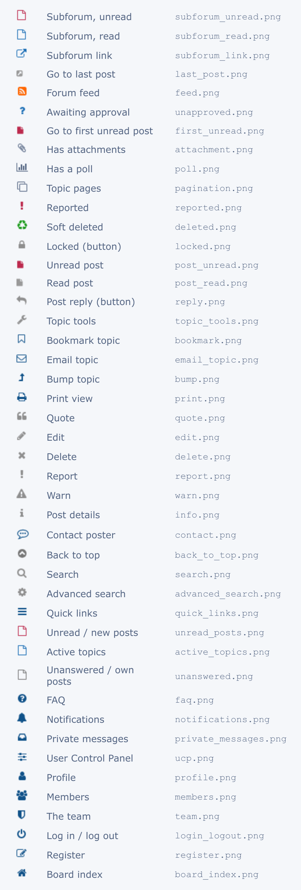

[](https://github.com/phpbbmodders/phpbb-icon-legend/actions/workflows/check.yml)

# phpBB Icon Legend

A ready-to-post forum guide to what every phpBB 3.3 prosilver icon means, with the small icons as real pictures.

## What's here

- **[`post/icon-legend.bbcode.txt`](post/icon-legend.bbcode.txt)**: the finished post. Copy it into any phpBB board's post editor. It covers the large forum, topic, sticky and announcement icons and every small icon a member sees: the red "first unread post" page, paperclip, padlock, post buttons, header menu and so on.
- **[`icons/`](icons/)**: the 45 small icons as transparent PNGs. The post links to them here.
- **[`scripts/`](scripts/)**: the scripts that draw the icons and build the post.

prosilver draws its small icons with the Font Awesome icon font, so there are no image files to link to. `render_icons.py` draws each one in headless Chromium with phpBB's own `font-awesome.min.css`, in prosilver's colours and sizes, and saves it as a PNG.

<a href="docs/images/icon-sheet.png"></a>

## Requirements

- Python 3.10 or newer
- To redraw the icons: [Playwright for Python](https://playwright.dev/python/) with Chromium, and a local phpBB 3.3 install to take the Font Awesome files from

## Usage

Rebuild the post after changing [`post/template.bbcode.txt`](post/template.bbcode.txt) or the icon list in `build_post.py`:

```bash
python3 scripts/build_post.py --write
```

Redraw the icons from a phpBB 3.3 install, with a review sheet:

```bash
python3 scripts/render_icons.py --board /path/to/phpBB3 --sheet docs/images/icon-sheet.png
```

Both scripts print their options when run without arguments. CI runs `build_post.py --check`, which fails if the built post is out of date or uses an icon with no PNG.

## Contributing

Contributions are welcome!

- **Bug reports**: [Open an issue](https://github.com/phpbbmodders/phpbb-icon-legend/issues).
- **Everything else** (questions, feature requests, ideas, general discussion): [Use Discussions](https://github.com/phpbbmodders/phpbb-icon-legend/discussions).
- Pull requests are welcome for bug fixes or discussed features.

## Acknowledgments

- The small icons are drawn from [Font Awesome 4.7](https://fontawesome.com/v4/) by Dave Gandy, which phpBB ships; the font is licensed under the SIL Open Font License 1.1.
- The large icons linked in the post are prosilver's own images, served by phpBB.com.
- Code, testing and documentation assisted by [Claude](https://www.anthropic.com/claude).

## License

This project is licensed under the **GNU General Public License v2.0**.

See [LICENSE](LICENSE) for more information.
